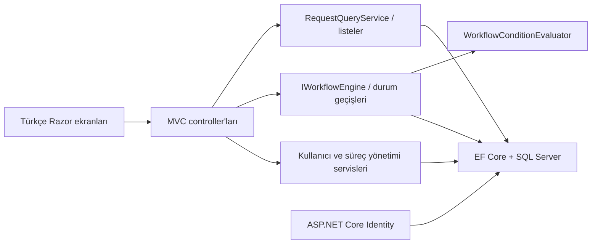

# Mimari ve tasarım kararları

Uygulama ASP.NET Core MVC tabanlı modüler bir monolittir. Tek web projesi içinde
HTTP, iş kuralları ve kalıcılık sorumlulukları klasörler ve servislerle ayrılır.
Bu boyuttaki portföy için dağıtık servis altyapısı gerektirmeden okunabilir ve
çalıştırılabilir bir yapı hedeflenmiştir.



| Bölüm | Sorumluluk |
| --- | --- |
| `Controllers`, `ViewModels`, `Views` | İstek doğrulama, kullanıcı arayüzü ve yönlendirme |
| `Domain` | Süreç, adım, koşul, talep, işlem geçmişi ve durumlar |
| `Services/Workflow` | Motor sözleşmeleri, koşul değerlendirme, durum geçişleri |
| `Services/Interfaces` | Motorun dışarı sunduğu arayüz |
| `Services` | Sorgular, süreç/kullanıcı yönetimi, ilk yönetici kurulumu |
| `Data` | Identity DbContext, Fluent API, migration, açık kurulum komutları |
| `tests` | Gerçek LocalDB ve MVC test sunucusu ile entegrasyon kontrolleri |

## İş kuralları

- Yayımlanan süreç değişmez. Yeni düzenleme, ayrı sürüm ve adım/koşul kimlikleriyle
  yapılır; eski talepler eski sürümde kalır.
- Bir süreç kodu için SQL filtreli benzersiz indeks tek etkin sürümü korur.
- Adım sırası süreç içinde benzersizdir. Bileşik yabancı anahtarlar bir talep veya
  geçmiş kaydının başka süreç sürümündeki adıma bağlanmasını engeller.
- Motor her çağrıda bağımsız DbContext/transaction kullanır. Talep durumu ve geçmişi
  birlikte kaydedilir; `rowversion` eski formları yakalar. SQL kilit çakışmaları
  kontrollü Conflict sonucuna dönüştürülür.
- Kimlik doğrulanmış kullanıcı kendi talebini oluşturabilir. Karar, güncel adımın
  rolü ve varsa kişi/departman ataması üzerinden verilir. Yönetici gerektiğinde
  doğrudan müdahale edebilir. Kendi talebine onay veya ret verilemez.
- Geçmiş uygulamanın EF Core kayıt yollarında yalnızca eklenebilir. Doğrudan SQL
  yönetim erişimi bu uygulama kuralının dışındadır.

## Doğrulama

Kontroller konsol projesidir; `dotnet test` keşfi kullanmaz. Ana test komutu:

```powershell
dotnet run --project tests/MiniWorkflowEngine.IntegrationChecks --configuration Release
```

Kontroller benzersiz geçici LocalDB veritabanları oluşturup sonunda siler.
Migration yükseltmesi, Identity/CSRF, kullanıcı/rol ve süreç ekranları, talep
ekranları, koşul sınırları, gerçek paralel kararlar ve kasıtlı SQL hatasında geri
alma doğrulanır.

## Grafik yürütme ve formlar

- Süreç sürümü, grafik ve form şemasını `GraphJson` alanında birlikte taşır.
  Yayımlama, insan görevlerini mevcut `WorkflowSteps` kayıtlarına bağlar.
  Böylece görev kutusu, yetki sorguları, `rowversion` ve işlem geçmişi ortak kalır.
- `GraphRules` düğüm bağlantılarını, değişken türlerini ve ulaşılabilirliği
  doğrular. `GraphRuntime` hem önizlemede hem gerçek yürütmede aynı yönlendirmeyi kullanır.
- Grafik bir seferde tek aktif adım yürütür. Bir kararın ilk eşleşen çıkışı
  kullanılır. Düzeltmeye iade, talep sahibine düzenleme hakkı verir ve yeniden
  gönderim aynı adıma döner. Düzeltme boyunca talep, yayımlanan sürümünü korur.
- Form alanları sabit anahtarlarla koşullara bağlanır. Taslak ve düzeltme
  aşamalarında talep sahibi form değerlerini günceller. Görevli, değerleri okuyup
  kendi adımını sonuçlandırır.
- Mevcut sıralı süreçler `GraphJson` boş olan sürümler üzerinden yürür. Bu
  süreçlerde eski koşul atlama ve onay kuralları uygulanmaya devam eder.

