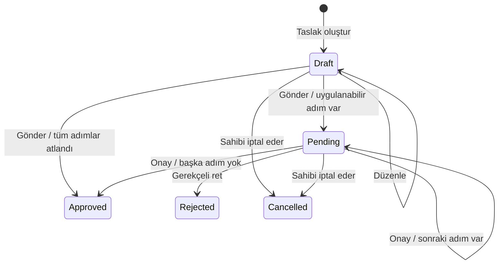

# MiniWorkflowEngine

ASP.NET Core MVC ile geliştirilen kurumsal iş akışı yönetimi portföy projesi.

## Gereksinimler ve çalıştırma

- .NET SDK 10.0.403 (veya aynı SDK bandındaki güncel yama)
- SQL Server veya geliştirme için SQL Server Express LocalDB (`MSSQLLocalDB`)

```powershell
dotnet restore
dotnet tool restore
dotnet build --no-restore
dotnet run --launch-profile https
```

Geliştirme adresi: https://localhost:7062. Gerekirse yerel HTTPS sertifikasına
`dotnet dev-certs https --trust` komutuyla güvenilebilir.

## Klasör yapısı

| Klasör | Sorumluluk |
| --- | --- |
| Controllers | HTTP istekleri ve MVC yönlendirme |
| Views | Razor görünümleri ve ortak yerleşim |
| Models | MVC şablonunun ortak modelleri |
| ViewModels | Ekranlara özel veri modelleri |
| Domain/Entities | İş alanı varlıkları ve Identity kullanıcı modeli |
| Domain/Enums | İş alanı durumları ve sabitleri |
| Data/Configurations | EF Core eşleme yapılandırmaları |
| Services/Interfaces | Uygulama servis sözleşmeleri |
| Services | İş kuralları ve uygulama servisleri |
| Extensions | Servis ve uygulama yapılandırma uzantıları |
| wwwroot | CSS, JavaScript ve statik dosyalar |

## Aşama 1

MVC iskeleti, SQL Server sağlayıcısı, EF Core tasarım araçları ve Identity EF Core
paketi hazırdır. Paket sürümleri 10.0.14 olarak sabitlenmiştir. SQL Server
sağlayıcısının geçişli bağımlılığındaki güvenlik uyarılarını gidermek için
System.Security.Cryptography.Pkcs 10.0.14 açıkça referanslanmıştır.

## Aşama 2

`ApplicationDbContext`, Identity kullanıcı/rol altyapısı ve ilk migration hazırdır.
Geliştirme bağlantısı `appsettings.Development.json` içinde Windows kimlik
doğrulamasıyla LocalDB'ye bağlanır. Parola içermez. Üretimde
`ConnectionStrings__DefaultConnection` ortam değişkenini tanımlayın; geliştirmedeki
`TrustServerCertificate=True` ayarını üretim bağlantısına taşımayın.

Veritabanını ve temel rolleri hazırlamak için:

```powershell
$env:ASPNETCORE_ENVIRONMENT = 'Development'
dotnet run --no-launch-profile -- --initialize-database
```

Bu komut migration'ları uygular, eksik rolleri oluşturur ve çıkar. Normal uygulama
açılışında migration veya seed çalışmaz. Kullanıcı ya da sabit parola eklenmez.
Roller: `Administrator` (yönetici), `Approver` (onaylayıcı), `Employee` (çalışan).
Giriş ekranı üçüncü aşamada eklenmiştir. Anonim ziyaretçiler girişe, rolü yetersiz
oturumlar 403 yanıtı veren erişim engeli sayfasına yönlenir.

Veri modeli:

- `WorkflowDefinition`: kod ve sürümle süreç tanımı; aynı kod için tek etkin sürüm.
- `WorkflowStep`: süreç içinde benzersiz sıra ve onaylayıcı Identity rolü.
- `StepCondition`: tutar/departman alanı, karşılaştırma operatörü ve değer.
  Koşulları değerlendiren motor sonraki aşamadadır. Tutar değerleri servis
  katmanında kültürden bağımsız biçimde doğrulanacaktır; bir adımdaki koşullar AND ile birleşecektir.
- `WorkflowRequest`: talep sahibi, bağlı süreç sürümü, tutar, durum ve geçerli adım.
- `RequestAction`: talep, adım, işlemi yapan kullanıcı, işlem türü ve zaman.

Bileşik yabancı anahtarlar, bir talebin veya geçmiş kaydının başka süreç sürümüne
ait adıma bağlanmasını engeller. Süreç tanımı ve taleplerde SQL Server `rowversion`
eşzamanlı güncellemeleri algılar. İş verilerinde otomatik zincirleme silme yoktur.
Yayımlanmış süreç sürümlerinin değiştirilememesi ve geçmişin yalnızca eklenebilmesi
gibi iş kuralları sonraki servis aşamasında uygulanacaktır.

### Entegrasyon doğrulaması

```powershell
dotnet run --project tests/MiniWorkflowEngine.IntegrationChecks --configuration Release
dotnet ef migrations has-pending-model-changes
```

Kontroller gerçek SQL Server LocalDB üzerinde benzersiz bir geçici veritabanı
oluşturur ve sonunda siler; uygulamanın veritabanını kullanmaz. Migration, rol
kurulumunun tekrar çalıştırılması, Identity parola/rol ilişkisi, talep/geçmiş
kayıtları, süreçler arası adım ilişkisinin reddi, benzersiz adım sırası ve
eşzamanlı güncelleme çatışması doğrulanır. Bu proje bir konsol doğrulama aracıdır;
`dotnet test` yerine yukarıdaki komutla çalıştırılır.

İlk migration'ın incelemeye uygun SQL çıktısı `Data/Migrations/InitialCreate.sql`
dosyasındadır. Projeye özel `dotnet-ef` aracı 10.0.14 sürümüne sabitlenmiştir.

## Aşama 3

Türkçe ve responsive giriş formu, oturum bilgisi, POST ile çıkış ve erişim engeli
sayfası hazırdır. Ana sayfa oturum gerektirir; `/Administration` yalnızca
`Administrator` rolüne açıktır. Yönetim bağlantısını gizlemekle birlikte sunucuda
da rol kontrolü uygulanır. Giriş, gizlilik, hata ve statik dosyalar anonim erişime
açıktır. Her MVC POST isteğinde CSRF doğrulaması uygulanır.

İlk yönetici hesabını kendi terminalinizde oluşturun:

```powershell
dotnet run --project MiniWorkflowEngine.csproj -- --create-admin
```

Komut e-posta, ad soyad ve parolayı iki kez sorar. Parola ekranda gösterilmez;
komut satırı argümanlarına, yapılandırmaya veya loglara yazılmaz. En az 10 karakter,
büyük/küçük harf, rakam ve özel karakter gereklidir. Yerel veritabanı ikinci aşamada
hazırlanmıştır; yeni kurulumlarda önce `--initialize-database` komutunu çalıştırın.
Bu komut halka açık bir kayıt sayfası değildir; sunucu/terminal erişimi gerektirir.
Uygulama veritabanına otomatik veya varsayılan parolalı hesap eklenmez.

Kurulum, mevcut bir hesabı yöneticiye yükseltmez ve bir yönetici zaten varsa yeni
hesap oluşturmaz. Kullanıcı oluşturma ve rol atama tek veritabanı transaction'ında
gerçekleşir. İşlem başarısız olursa kısmi kullanıcı kaydı bırakılmaz. Entegrasyon
testlerindeki hesaplar yalnızca geçici veritabanlarında oluşturulur.

Uygulamayı `dotnet run --project MiniWorkflowEngine.csproj` ile açın. Varsayılan
profil HTTPS kullanır: https://localhost:7062/Account/Login. Kimlik doğrulama ve
CSRF çerezleri HTTPS gerektirir. Oturum çerezi `Secure`, `HttpOnly`, `SameSite=Lax`
ayarlarını kullanır. Oturum süresi 8 saattir; etkin kullanımda yenilenir.
Beş yanlış parola denemesinde hesap 15 dakika kilitlenir. Hatalı giriş yanıtı
hesabın varlığını veya kilit durumunu ayrı ayrı açıklamaz. Dönüş adresleri yalnızca
uygulama içi adreslerle sınırlandırılmıştır. MVC yanıtları önbelleğe alınmaz.

Entegrasyon komutu artık gerçek MVC işlem hattını test sunucusunda da çalıştırır:
ilk yönetici kurulumu, parola politikası, tekrar kurulum engeli, anonim erişim,
CSRF, yanlış parola, güvenli çerez, dış adrese yönlendirme engeli, yönetici/çalışan
yetki ayrımı, çıkış ve hesap kilidi kontrol edilir. Test parolaları örnektir;
uygulama veritabanında kullanılmaz. Şemada değişiklik olmadığı için yeni migration yoktur.

## Aşama 4

Yönetici hesabıyla **Yönetim → Kullanıcı yönetimi** üzerinden `/Users` ekranına
ulaşılır. Kullanıcılar ad/e-posta ile aranabilir ve 20 kayıtlık sayfalar halinde
listelenir. Her kullanıcı için ad, e-posta, Türkçe rol adları ve oluşturulma zamanı
(UTC) gösterilir. Boş sonuçlar ve başarılı işlemler için açıklayıcı mesajlar vardır.

`/Users/Create` ekranında ad soyad, e-posta, ilk giriş parolası ve parola tekrarı
girilir. En az bir rol gerekir; bir kullanıcı birden fazla rol alabilir. Yeni
formda Çalışan rolü seçilidir. Parola politikasına ek olarak bu form 128 karakter
üst sınırı uygular. Parola veritabanına Identity tarafından hash'lenerek kaydedilir;
hatalı form yanıtlarında parola alanları boşaltılır. E-posta/parola dağıtımı
otomatik değildir; yönetici ilk giriş parolasını kullanıcıya güvenli kanaldan iletir.

`/Users/Roles/{id}` ekranı mevcut rollerin değiştirilmesini sağlar. Ekranlar ve
POST işlemleri yalnızca yöneticilere açıktır. Servis katmanı işlemi yapan hesabın
güncel yönetici rolünü de kontrol eder. Tanımlanmamış roller, boş rol seçimi ve
mükerrer e-posta reddedilir. Kullanıcı oluşturma/rol atama ve rol güncellemeleri
transaction içinde uygulanır; başarısız işlem kısmi veri bırakmaz.

Son yöneticinin yönetici rolü kaldırılamaz. Seri hale getirilebilir transaction
izolasyonu bu kontrolü ve güncellemeyi birlikte korur. Eski formdan gönderilen
değişiklikler Identity `ConcurrencyStamp` ile reddedilir; kullanıcı formu yeniler.
URL ve formdaki kullanıcı kimlikleri de eşleşmelidir.

Rol değişikliğinde security stamp yenilenir. Eski oturumlar bir sonraki istekte
geçersiz olur; kullanıcı yeniden giriş yapar. Yönetici kendi rollerini değiştirirse
mevcut oturumu yeni rollerle yenilenir. Başka bir yönetici mevcutken kendi yönetici
rolünü kaldırabilir; bu durumda ana sayfaya döner. Bu portföy sürümünde damga
doğrulaması her kimliği doğrulanmış istekte veritabanına erişir; bu, yetki
değişikliklerini sonraki istekte uygulamak için tercih edilmiştir.

Entegrasyon kontrollerine yetkisiz doğrudan POST, CSRF, boş/geçersiz roller,
parola doğrulaması, çoklu rolle oluşturma, mükerrer e-posta, arama/sayfa sınırı,
bulunamayan kullanıcı, son yönetici koruması, eski formun reddi ve rol değişikliği
sonrası oturum davranışı eklendi. Kontroller izole geçici veritabanlarında çalışır.
Bu aşama mevcut Identity tablolarını kullanır; yeni migration gerektirmez.

## Aşama 5

**Yönetim → Süreç tanımları** (`/Workflows`) ekranında kod/ad ile arama ve 20
kayıtlık sayfalama vardır. Yönetici süreç kodu, adı ve açıklamasını tanımlar;
1–20 sıralı onay adımı ekler. Her adımın adı ve onaylayıcı rolü zorunludur.
Sıra, yukarı/aşağı düğmeleriyle değişir; kayıt sırasında 1'den başlayan kesintisiz
sıra numaraları atanır. Bu ekran bir form düzenleyicisidir; BPMN editörü içermez.

Adım başına 0–10 koşul eklenebilir. Koşulsuz adım her talepte uygulanmak üzere
tanımlanır; bir adımdaki tüm koşullar **VE** ile birleşir. Tutar için altı
karşılaştırma (eşittir, eşit değildir, büyüktür, büyük/eşit, küçüktür, küçük/eşit),
departman için yalnızca eşittir/eşit değildir kullanılabilir. Tutar negatif olamaz;
en fazla 16 tam sayı ve iki ondalık basamak kabul edilir. `1000,50` veya `1000.50`
girilebilir; binlik ayırıcı, bilimsel gösterim ve belirsiz biçimler reddedilir.
Veritabanında tutar koşulları kültürden bağımsız `1000.50` biçiminde saklanır.
Departman değerleri kırpılır ve 100 karakterle sınırlandırılır. Koşulların talep
üzerinde değerlendirilmesi sonraki Workflow Engine aşamasındadır.

Yaşam döngüsü:

1. **Taslak:** Süreç, adımları ve koşulları tek transaction içinde kaydedilir.
   Taslak düzenlenebilir; süreç kodu değiştirilemez. Her alt kayıt değişikliğinde
   üst tanımın `rowversion` değeri de yenilenir; eski formlar reddedilir.
2. **Yayımla:** Tanım değişmez hale gelir ve etkinleşir. Aynı kodun önceki etkin
   sürümü aynı transaction içinde arşivlenir. Bir kod için tek etkin sürüm vardır.
3. **Yeni sürüm:** Yayımlanmış tanımın adım/koşulları yeni kimliklerle bir sonraki
   sürüme kopyalanır. Aynı kodun açık taslağı varsa yeni taslak oluşturulmaz.
4. **Devre dışı bırak:** Etkin sürüm arşivlenir; düzenlenebilir taslağa dönüşmez.
   Yeniden kullanıma açmak için yeni bir sürüm hazırlanıp yayımlanır.

Mevcut talepler kendi süreç sürümlerine bağlı kalır. Bir tanım talepte kullanılmışsa
yayın tarihi olmasa bile düzenlenmesi engellenir. Yeni talep açma ve onay yürütme
servisleri altıncı aşamada eklenmiştir. Taslak/yayın işlemleri sunucuda yönetici rolü ve CSRF ile korunur;
gönderilen rol, alan, operatör ve değerler tekrar doğrulanır. JavaScript adım/koşul
ekleme, kaldırma ve sıralamada kullanılır; iş kurallarının yetkili kaynağı sunucudur.

`AddWorkflowPublication` migration'ı yayın tarihini ekler. Önceden etkin olan veya
talepte kullanılmış tanımlara mevcut oluşturulma tarihiyle yayın işareti atanır;
mevcut taslaklar taslak kalır. Yeni kurulumlarda ve yükseltmelerde:

```powershell
dotnet run --project MiniWorkflowEngine.csproj -- --initialize-database
```

Migration yükseltmesi, hatalı koşullar/roller, süreç oluşturma/düzenleme, kod
benzersizliği, eski form engeli, yayımlama, yeni sürüm kopyalama, tek etkin sürüm,
devre dışı bırakma ve eski talebin sürüm bağlantısı entegrasyon kontrolleriyle
doğrulanır. SQL yükseltme çıktısı `Data/Migrations/UpgradeWorkflowPublication.sql`
dosyasındadır.

## Aşama 6

`IWorkflowEngine` arayüzü ve `WorkflowEngine` uygulaması DI ile kullanılabilir.
Bu aşama servis katmanını tamamlar; talep/onay controller ve ekranları yedinci
aşamada eklenmiştir. Servis işlemleri:

| İşlem | Kural |
| --- | --- |
| `CreateDraftAsync` | Etkin/yayımlanmış süreç sürümüne bağlı taslak oluşturur. |
| `UpdateDraftAsync` | Yalnızca talep sahibi taslağın başlık, açıklama, tutar ve departmanını değiştirir. Süreç sürümü sabittir. |
| `SubmitAsync` | Talep sahibi taslağı gönderir; ilk uygulanabilir onay adımı seçilir. |
| `ApproveAsync` | Geçerli adımın rolündeki kullanıcı onaylar; sonraki uygulanabilir adıma geçilir. |
| `RejectAsync` | Geçerli adımın rolündeki kullanıcı gerekçe yazarak talebi sonlandırır. |
| `CancelAsync` | Talep sahibi kendi taslağını veya bekleyen talebini iptal eder. |
| `GetAsync` | Yetkili kullanıcı için durum, güncel adım, sürüm ve işlem geçmişinin anlık görüntüsünü döndürür. |



Servise `actorId` olarak oturumdaki kullanıcının güvenilir kimliği verilmelidir;
gelecek controller'lar bu değeri formdan değil kullanıcı claim'inden alacaktır.
Motor hesabın varlığını ve kilit durumunu, işlem anındaki rol üyeliğini tekrar
kontrol eder. Bir yönetici, adımın onaylayıcı rolüne sahip değilse karar veremez.
Talep sahibi, rolü uygun olsa bile kendi talebini onaylayamaz veya reddedemez.
Tamamlanmış, reddedilmiş veya iptal edilmiş talep yeniden yürütülemez.

Talebi sahibi, yöneticiler, geçerli adımın rolündeki kullanıcılar ve geçmişte
talepte işlem yapmış kullanıcılar okuyabilir. Diğer kullanıcılara talebin varlığı
açıklanmaz. Herhangi bir oturum açmış ve kilitli olmayan hesap kendi talebini
oluşturabilir; onay yetkisi ayrıca adım rolünden belirlenir.

`WorkflowConditionEvaluator` tutarları `decimal` ile, departmanları Türkçe
kültürüne uygun ve büyük/küçük harf duyarsız karşılaştırır; dış boşlukları kırpar.
Bir adımdaki koşullar VE ile birleşir. Süreç herhangi bir tutar/departman koşulu
içeriyorsa o alan gönderim sırasında zorunludur. Eksik veri eşit değildir
karşılaştırmasını da sağlamaz. Bozuk alan, operatör, değer, sıra veya rol içeren
tanım güvenli biçimde reddedilir; kısmi karar oluşmaz.

Koşulu sağlanmayan adımlar `StepSkipped` olarak kaydedilir. Tüm adımlar atlanırsa
talep otomatik `Approved` olur; insan onayı kaydı üretilmez, `Completed` kaydı
oluşturulur. Son onaydan sonra da `Completed` kaydı yazılır. Otomatik kayıtların
`ActorId` alanı akışı ilerleten kullanıcıdır; işlem türü otomatik işlemi belirtir.
Taslak oluşturma/güncelleme, gönderim, onay, ret ve iptal de geçmişe eklenir.
Geçmiş kayıtları kimliğe göre sıralanır ve zamanları UTC olarak tutulur.

Arşivlenen sürümle yeni taslak açılamaz ve bu sürümdeki eski taslak gönderilemez;
etkin sürümle yeni talep gerekir. Daha önce gönderilmiş talepler ise kendi
arşivlenmiş sürümlerindeki adımlarla tamamlanır. Gönderilmiş talebin tutar ve
departmanı motor üzerinden değiştirilemez; sonraki koşullar aynı veriyle yürür.

Her motor çağrısı bağımsız DbContext ve seri hale getirilebilir transaction
kullanır. Talep durumu, geçerli adım, tamamlanma zamanı ve geçmiş birlikte
kaydedilir. Değişiklik komutlarında Base64 `RowVersion` zorunludur. Eski form,
çift karar veya SQL kilit çakışması `WorkflowError.Conflict` döndürür; istemci
güncel talebi yüklemelidir. Beklenmeyen veritabanı hataları çağırana iletilir ve
transaction geri alınır. `WorkflowResult` diğer durumlarda doğrulama, yetki,
durum ve tanım hatalarını ayrı kodlarla döndürür.

`ApplicationDbContext` normal EF Core `SaveChanges` yollarında mevcut
`RequestAction` kayıtlarının değiştirilmesini/silinmesini engeller; yalnızca
ekleme yapılır. Bu uygulama katmanı korumasıdır; doğrudan SQL yönetim yetkisi olan
bir kullanıcının veritabanına müdahalesini kısıtlamaz. Şema değişmediğinden bu
aşamada yeni migration yoktur.

Entegrasyon komutu ayrıca altı tutar karşılaştırmasının sınırlarını, Türkçe
departman/VE mantığını, üç aşamalı onayı, sahiplik ve rol geri alma kontrollerini,
ret/iptali, eski sürümde devam etmeyi, tüm adımların atlanmasını, geçmişin
değişmezliğini ve bozuk tanımda geri almayı doğrular. Gerçek paralel çağrılarla
çift gönderim, çift onay ve onay/iptal yarışı test edilir. Geçici test veritabanında
kasıtlı SQL kısıt hatası üretilerek geçmiş yazımı başarısız olduğunda talep
durumunun ve sürümünün de geri alındığı kontrol edilir.

## Aşama 7

Ana sayfa ve üst menü üzerinden çalışan talep/onay ekranlarına erişilir:

| Ekran | Adres | Davranış |
| --- | --- | --- |
| Taleplerim | `/Requests` | Yalnızca oturumdaki kullanıcının talepleri; başlık/süreç araması, durum filtresi ve 20 kayıtlık sayfalama. |
| Talep oluştur | `/Requests/Create` | Etkin/yayımlanmış süreç seçimiyle taslak oluşturur. |
| Taslağı düzenle | `/Requests/Edit/{id}` | Yalnızca talep sahibine açık; başlık, açıklama, tutar ve departman düzenlenir. |
| Bekleyen onaylar | `/Requests/Inbox` | Geçerli adımın rolü kullanıcıda olan bekleyen talepler; kendi talepleri hariç. |
| Talep detayı | `/Requests/Details/{id}` | Talep sahibi, süreç sürümü, durum, güncel adım, bilgiler ve zaman çizelgesi. Yetkiye göre işlem düğmeleri görünür. |

Örnek kullanım: yönetici bir süreç yayımlar ve gerekli onaylayıcı rolüne sahip
kullanıcı oluşturur. Çalışan taslağını kaydeder, detaydan **Onaya gönder** der.
İlgili rolün kullanıcısı **Bekleyen onaylar** ekranından talebi açıp **Onayla**
veya gerekçe girerek **Reddet** seçer. İlerleyen adımlar sonraki rolün kutusuna
yansır. Talep sahibi taslak/bekleyen talebini detaydan iptal edebilir.

Formda tutar metin olarak alınır ve sıkı biçimde `decimal` değerine dönüştürülür;
`1000,50` ve `1000.50` aynı tutardır. Binlik ayırıcı, negatif değer, bilimsel
gösterim ve ikiden fazla ondalık basamak reddedilir. Böylece Türkçe model bağlama
kurallarının noktalı değeri yanlışlıkla yüz kat büyük yorumlaması engellenir.
Seçilen süreçte hangi koşul alanlarının gönderimde zorunlu olduğu formda belirtilir;
taslaklar eksik koşul alanlarıyla kaydedilebilir. Etkin süreç yoksa açıklayıcı
bir boş durum gösterilir. Arşiv sürümdeki taslak gönderilemez.

Tüm durum değişiklikleri `IWorkflowEngine` üzerinden yapılır. Kullanıcı kimliği
oturum claim'inden alınır; formdan gelen sahip, durum veya adım bilgisi kullanılmaz.
İşlem düğmelerinin gizlenmesine ek olarak motor yetkiyi tekrar denetler.
İlgisiz kullanıcı detay/düzenleme için 404, erişimi olup işlemi yapamayan kullanıcı
403 alır. POST işlemleri CSRF korumalıdır ve URL/form kimlikleri eşleştirilir.
Eski taslak veya karar sürümü 409 döndürür; açıklayıcı hata ve güncel kaydı yükleme
yolu sunulur. Başarılı işlemler detay sayfasına yönlenir ve mesaj gösterir.

Detayda oluşturma, güncelleme, gönderim, onay, ret, iptal, otomatik adım atlama ve
tamamlanma kayıtları Türkçe zaman çizelgesiyle gösterilir. Kullanıcı metinleri
Razor ile kodlanır; açıklama/not içindeki HTML çalıştırılmaz. Tarihler açıkça UTC
olarak etiketlenir. Listeler dar ekranlarda yatay kaydırılır; detay kartları ve
navigasyon mobil genişliğe göre yerleşir.

HTTP entegrasyon kontrolleri oluşturma/düzenleme/gönderme/onay/ret/iptal akışını,
oturum ve rol ayrımını, sahip/durum alanı manipülasyonunu, CSRF, URL kimliği,
eski formu, Türkçe/noktalı tutarları, HTML kodlamayı, arama/filtreleri ve boş
durumları kapsar. Kontroller geçici LocalDB veritabanlarında çalışır; uygulama
veritabanına örnek hesap veya talep eklenmez. Şema değişikliği ve yeni migration yoktur.


