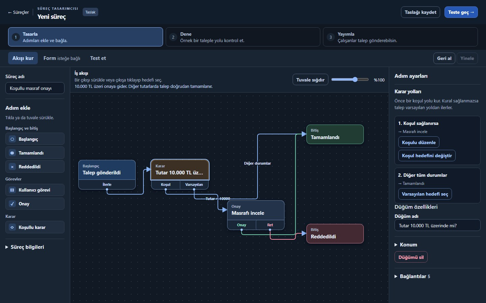
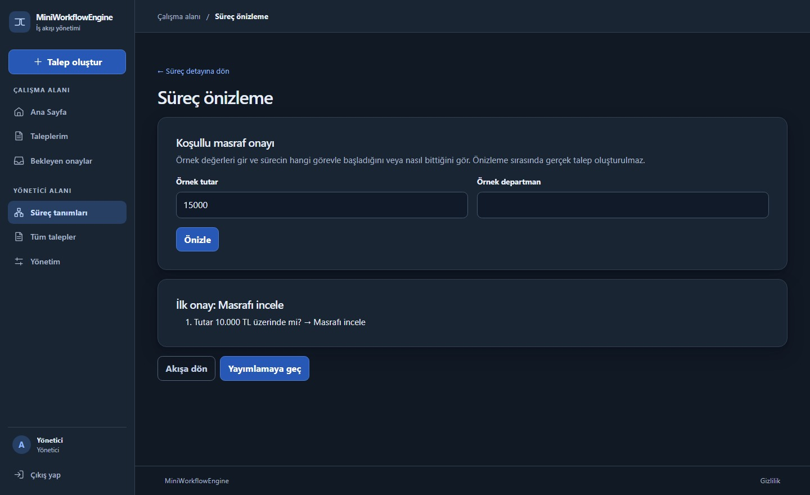
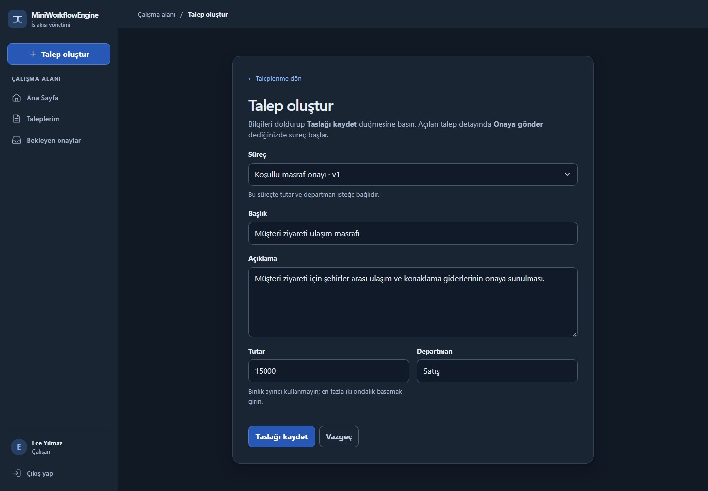
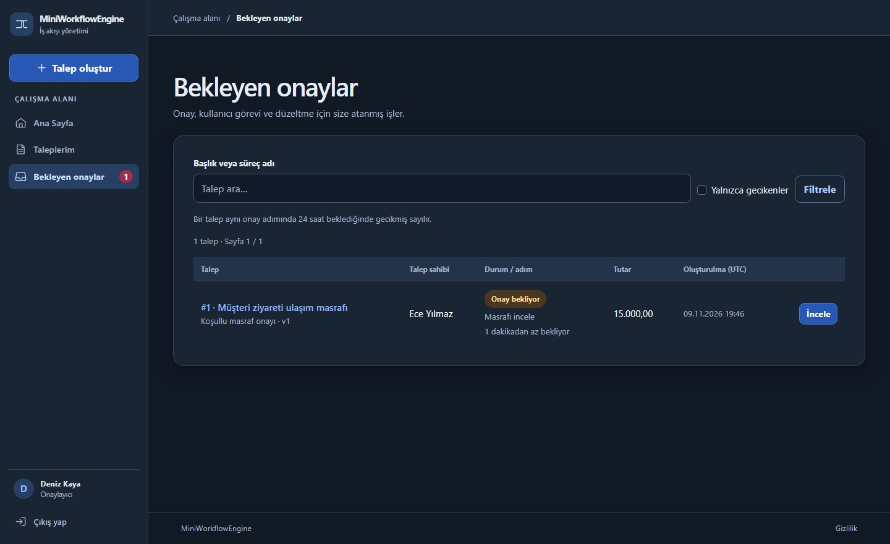
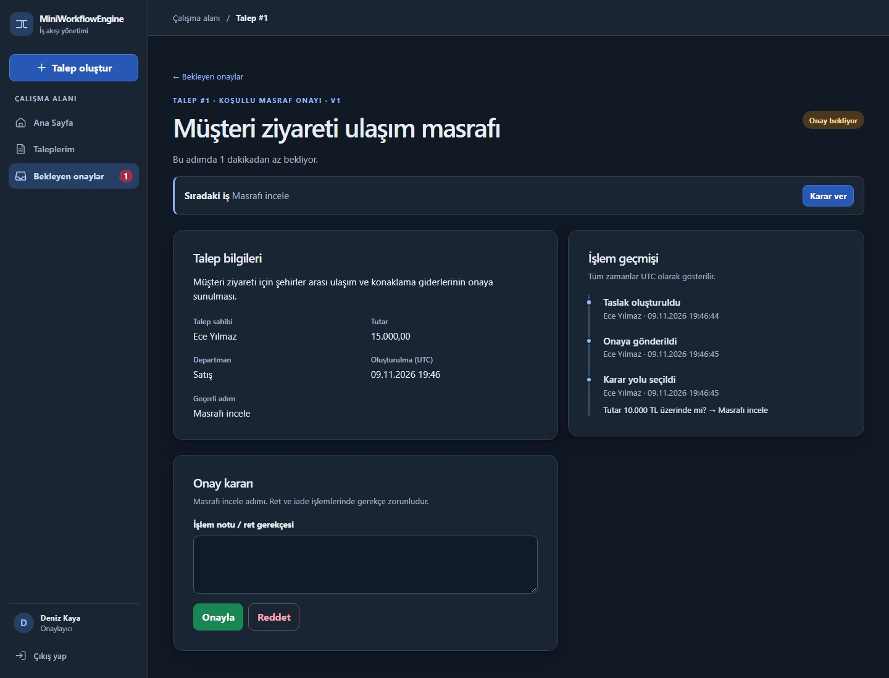
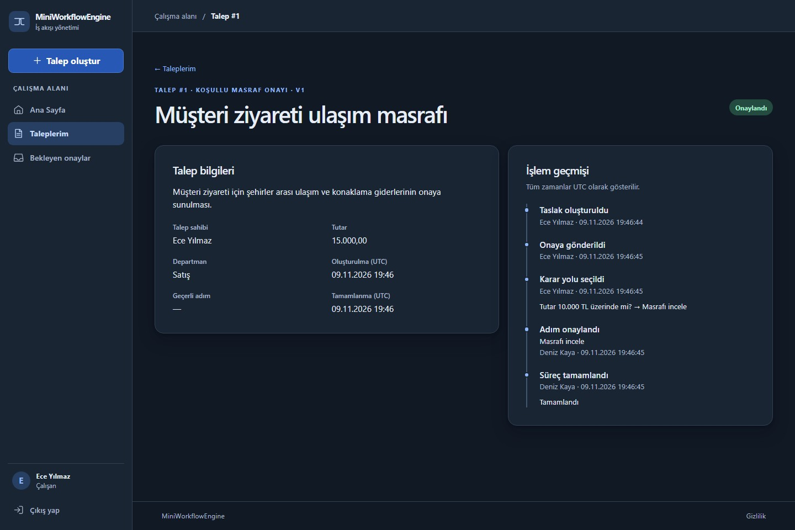

# Ekran görüntüleri

**10.000 TL masraf örneği** tuvale hazır bağlantılarla gelir. Karar düğümü, 10.000 TL üzerindeki talepleri **Masrafı incele** adımına, diğer talepleri **Tamamlandı** düğümüne yönlendirir.

Yönetici, **Teste geç → Kaydet ve test et** ile 15.000 TL tutarın hangi onay adımına gideceğini yayımlamadan önce görür.

Süreç yayımlandıktan sonra çalışan, müşteri ziyareti için 15.000 TL tutarında bir masraf talebi oluşturur ve onaya gönderir.

Onaylayıcı, menüdeki **1** rozetiyle bekleyen talebi fark eder ve **İncele** ile açar.

Onaylayıcı, talebi inceler ve onaylar. Reddederse gerekçe girer.

Çalışan, talebin sonucunu ve kimin ne zaman karar verdiğini görür.
